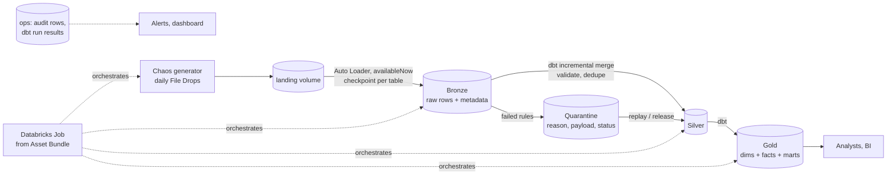

# Interview log

Answers about the whole platform, organised by the questions a data engineering interviewer asks. It is not a diary of how it was built.

**How to read the numbers**
- **Measured:** observed on Databricks, in Delta history, in SQL on the tables, in CI, or in a local Spark benchmark. See the evidence bank.
- **Projected:** arithmetic from a measured number. Say "projected" out loud in the interview.
- **Pending:** the measurement doesn't exist yet. Replace it when it does, and never quote a pending number.

**How to maintain it:** after each ticket, add the new measurements to the evidence bank, replace the `Pending` markers they settle, and rewrite any answer the new work changes. Answers should stay holistic: the decision, the alternative, the impact, scale, and what you'd do differently.

## Evidence bank

| # | Fact | Value | Source |
|---|---|---|---|
| E1 | Source data | Olist: 99,441 Customer rows, 96,096 distinct `customer_unique_id` | generator test |
| E2 | One daily Customer File Drop | 331 rows, 326 Customers, 2 bad ZIPs, 5 exact duplicates, 0 rescued values | SQL on Bronze |
| E3 | Silver on that drop | 324 Customers. Removed 7 rows (2.1%); 2 Customers (0.6%) lost entirely because their only row was malformed | SQL on Bronze and Gold |
| E4 | Gold key integrity | 324 rows, 324 distinct `customer_key`, `unique` and `not_null` tested on both keys | dbt tests |
| E5 | Idempotency | 4 job runs on the same File Drop produced 1 Bronze write (`numOutputRows=331`); Bronze 331 and Gold 324 after every run | Delta `DESCRIBE HISTORY` |
| E6 | Incremental vs full reload | 90 drops, 207,517 rows, Spark `local[2]`: full reload 5.3 to 9.5 s; one new day (5,602 rows) 1.9 s; rerun with nothing new 1.7 s, 0 rows | local benchmark |
| E7 | End-to-end job | 91 to 101 s: generate 13 to 16 s, Bronze 10 to 23 s, dbt 57 to 58 s (about 60%) | Jobs API |
| E8 | Storage density | 331 rows in 12,366 bytes of zstd Parquet, about 37 bytes per row | `DESCRIBE DETAIL` |
| E9 | CI gates | 13 checks on every PR. Mutation score 87.4% (floor 85%); 0 known vulnerabilities in 132 locked packages; a planted fake key blocked by gitleaks | CI |
| E10 | Least privilege | The staging deploy principal was denied creating a schema in `prod` and allowed in `staging` | CLI proof as the principal |
| E11 | Reproducibility | The same seed produces byte-identical File Drops (`diff -r` on two runs) | generator test |
| E12 | Credentials | 2 deploy principals, OAuth M2M secrets with 90-day expiry, prod behind 1 required reviewer | GitHub Environments |
| E13 | Cost | $0: Databricks Free Edition, serverless only, public GitHub Actions minutes | billing |

Pending: slim CI build counts and time, staging-to-prod lead time, rollback time, quarantine rate over time, SCD2 versions per Customer, `merge` vs `insert_overwrite` timings, partitioning vs liquid clustering pruning, the slow query before and after, PII masking proof.

## The pitch

**30 seconds:** "I built a customer analytics platform on Databricks that runs like a production system. Daily file drops of real Brazilian e-commerce data, with injected duplicates, malformed rows, schema drift and address changes, land in a Bronze Delta layer through Auto Loader. dbt cleans, deduplicates and quarantines them into Silver, and builds a Kimball star in Gold with an SCD Type 2 Customer dimension. Everything is code: a Databricks Asset Bundle defines the jobs, schemas and grants, and GitHub Actions tests every PR, deploys to staging and promotes the same commit to prod after approval. Nobody touches the Databricks UI."

**2 minutes, add:** "Three properties I designed for. First, every rerun is safe: four runs on the same file wrote Bronze exactly once. Second, nothing is silently lost: Bronze keeps every raw row, and failed rows go to quarantine with a reason and a replay path. I found that dropping bad rows cost 0.6% of Customers with no trace. Third, change is cheap and safe: 13 CI gates including mutation testing at 87.4%, per-developer and per-PR schemas, staging before prod, and a tested rollback. Incremental loading was 3 to 5 times faster than full reloads at 91 days of history, and the gap grows every day, which is what matters at terabyte scale."

## Architecture

| Layer | Holds | Load pattern | Owned by |
|---|---|---|---|
| Landing | Raw File Drops: Customers as full CSV snapshots, Orders, Order Items and Payments as incremental JSON | Append-only files | Generator |
| Bronze | Every row as received, all strings, plus `_source_file`, `_ingested_at`, `_file_drop_date`, `_rescued_data` | Auto Loader, `availableNow`, append | PySpark job task |
| Silver | Typed, standardised, one row per natural key; `quarantine` for rows that fail rules | dbt incremental `merge`, 3-day lookback | dbt |
| Gold | Kimball star: `dim_customer` (SCD2), `dim_product`, `dim_seller`, `dim_date`, `fct_order_items`, `fct_payments`, `fct_orders`, `customer_rfm` | dbt; facts merged on grain key | dbt |
| Ops | One audit row per task run, dbt `run_results` | Append | Job tasks |

Environments are Unity Catalog catalogs `dev`, `staging` and `prod`. Developers get `dev.dbt_<user>_*` schemas, PRs get `dev.ci_pr_<n>_*`, and staging and prod use plain `bronze`, `silver`, `gold`.

## Design questions

### Why a medallion architecture?

**Answer:** "Each layer has one job, so each failure has one place to look. Bronze is the system of record: every row exactly as it arrived, with where and when it came from. That means I can rebuild Silver and Gold from Bronze at any time without asking the source to resend anything. Silver is where business rules live: types, standardisation, dedupe and quarantine. Gold is the contract with analysts: modelled, tested, stable column names."

**Impact:** "On one daily drop, Bronze kept all 331 rows, including 5 duplicates and 2 malformed rows (E2). Because Bronze kept them, I could measure what Silver removed and prove that 2 Customers went missing (E3). Without a raw layer, that loss would be invisible."

**How I'd do it differently:**
- **Fewer layers:** a small team with clean sources could go straight from raw to modelled views. That's fewer tables to maintain, but there's no replay without the source.
- **Lakeflow Declarative Pipelines:** these manage the layers, dependencies and quality expectations for you. That's a good choice for a team that wants less code. I chose a plain job plus dbt so every mechanism (checkpoints, merges, quarantine) is visible and testable.

**Follow-ups:**
- *"Isn't keeping every raw row expensive?"* "At 37 bytes a row compressed (E8), a year of 2.7 GB days is about 1 TB, which costs tens of dollars a month in object storage at list prices. A rebuild that requires the source to resend data costs far more."
- *"When would you not keep raw data?"* "When it contains data you're not allowed to retain, like card numbers. Then you mask or tokenise at ingestion and document it."

### Why dbt for Silver and Gold, rather than PySpark?

**Answer:** "I split by what each tool is best at. PySpark owns ingestion, because file discovery, streaming checkpoints and schema rescue are Spark APIs with no SQL equivalent. dbt owns transformations, for five reasons:
1. **Dependencies are declared, not coded.** `ref('stg_customers')` builds the DAG, so models run in the right order and lineage comes for free.
2. **Testing is built in.** Unit tests on fixed rows prove the tricky logic, like the dedupe tie-break, and data tests (`unique`, `not_null`, `relationships`) run on every build.
3. **Environments in one place.** One `generate_schema_name` macro routes every model to `dbt_<user>_silver` in dev and `silver` in prod. In PySpark I'd thread environment names through every job.
4. **Slim CI.** `dbt build --select state:modified+ --defer` builds only the models a PR changed and their children, against prod's manifest.
5. **SQL is the shared language.** Analysts can read, review and contribute to SQL models, which widens who can safely change the logic."

**Impact:** "The whole Customer cleaning, validation and dedupe is 37 lines of SQL with 3 unit tests that run without touching real data. dbt was 57 seconds of a 91-second run (E7), and on 331 rows that's almost all fixed overhead: connection, compile, and 11 test queries. Pending: slim CI models built per PR versus the full project, and CI minutes saved."

**How I'd do it differently:**
- **All PySpark with Delta `MERGE`:** better when transformations need Python, like ML features, complex parsing or calling an API. The cost is that testing, lineage and environment routing are code you write and maintain.
- **SQLMesh instead of dbt:** virtual environments make dev and CI builds nearly free, and it understands column-level changes. dbt has the bigger ecosystem and hiring pool, which is why I picked it.
- **Lakeflow Declarative Pipelines with expectations:** quality rules are declarative and managed, but Free Edition allows one active pipeline per type, and I wanted the mechanics visible.

**Follow-ups:**
- *"Where does dbt hurt?"* "Complex procedural logic, and anything stateful across runs that isn't a merge. Jinja can become unreadable. I keep macros small and tested."
- *"How does dbt run on Databricks here?"* "As a dbt task in the job, on the serverless SQL warehouse, using the repo's `profiles.yml`. I found that the task silently ignores your profile if you also set `warehouse_id`, so the task doesn't set it."
- *"What does `--defer` do?"* "Unchanged upstream models resolve to prod's tables instead of being rebuilt, so a PR that changes one Gold model builds one model, not the whole DAG."

### How do you ingest files? Why Auto Loader?

**Answer:** "Auto Loader with `trigger(availableNow=True)` in a scheduled job. It discovers new files, records each file it has committed in a checkpoint, and stops when there's nothing left. So it behaves like a batch job with exactly-once file tracking. Each table has its own checkpoint and schema location, outside the folder it watches."

**Impact:** "Measured on 90 days of drops (E6): one new day loaded in 1.9 s against 5.3 to 9.5 s for a full reload, 2.9 to 5 times faster. A rerun with nothing new took 1.7 s and wrote 0 rows. Full-reload cost grows with total history, while incremental cost grows with one day, so the ratio keeps widening. Compute: a 95-second daily run instead of an always-on stream is about 900 times less compute time per day (projected: 86,400 / 95)."

**How I'd do it differently:**
- **`COPY INTO`:** also idempotent per file, and pure SQL, so it could live in dbt. It's simpler, but you get less control over schema evolution and rescue, and it doesn't scale as well to millions of files.
- **Continuous streaming** (`processingTime="1 minute"`): when consumers need minutes of freshness, not daily. It's a one-line change, but the cluster runs 24/7.
- **Event-driven ingestion:** trigger the job on file arrival instead of a schedule, so latency drops from up to a day to minutes, while still using `availableNow`.

**Follow-ups:**
- *"What if the checkpoint is deleted?"* "Auto Loader reloads every file and Bronze doubles. Silver's dedupe still produces correct Customers, which is why dedupe sits downstream of an append-only Bronze. Then I'd rebuild Bronze from the files."
- *"Why not infer column types?"* "A value that doesn't fit the inferred type moves to `_rescued_data`, splitting one column's data across two places. Bronze reads strings, and Silver casts with `try_cast`."
- *"What if a source resends a corrected file under a new name?"* "Both load, because Auto Loader tracks paths, not content. Silver's dedupe picks the correction deterministically."

### Batch or incremental? How do you choose?

**Answer:** "It's per layer and per entity. Customers arrive as full daily snapshots, so Bronze appends them incrementally by file, and Silver works out what changed. Orders, Order Items and Payments arrive as incremental JSON. Silver is an incremental `merge` on the natural key with a 3-day lookback, so late rows are caught without a rebuild. A weekly full refresh in staging is compared with the incremental result, to prove that incremental is correct, not just fast."

**Impact:** Measured: incremental Bronze was 2.9 to 5 times faster at 91 files (E6). Pending: Silver `merge` time vs full rebuild, and the weekly full-refresh diff, which should be 0 rows.

**How I'd do it differently:** "Full rebuilds are the right call for small tables, under a few GB, where simplicity beats speed. Change data feed or CDC from the source, instead of snapshots, would let Silver read only the changed rows, without computing the diff itself."

**Follow-ups:**
- *"Why a 3-day lookback?"* "It's a trade-off: wider catches later data but reprocesses more. I'd set it from the measured lateness distribution, the 99.9th percentile of `_ingested_at` minus the event date."
- *"How do you prove incremental equals full?"* "Build both and run an `except all` in both directions; the result must be 0 rows."

### How do you make the pipeline idempotent?

**Answer:** "At every layer, because one weak link breaks it:
1. **File names** are deterministic, derived from the business date, so a regenerated drop has the same path.
2. **Bronze** commits each file once through the Auto Loader checkpoint.
3. **Silver** dedupes with a total order: latest `updated_at`, then latest `_ingested_at`, then greatest `_source_file`. Ties are broken the same way every run.
4. **Gold keys** are hashes of natural keys, so a rebuild gives every row the same key.
5. **Facts** merge on their grain key, so a retry updates rows instead of duplicating them."

**Impact:** "Four runs on the same file produced one Bronze write, 331 rows (E5). Bronze stayed at 331 and Gold at 324 after every run."

**How I'd do it differently:** "Write-audit-publish: build into a staging branch of the table, run checks, then publish atomically. It's stronger, because a half-finished run is never visible, but it costs an extra copy and more orchestration."

**Follow-ups:**
- *"Give me a case where it would have broken."* "I briefly named files with a wall-clock timestamp, to look like real exports. A regenerated day then had a new path, so Auto Loader would load it again and Bronze would go from 331 to 662 rows with nothing failing. A rerun test made me trace it."
- *"Why not `monotonically_increasing_id()` for keys?"* "It changes on every rebuild, so every fact pointing at a dimension would need re-pointing."

### How do you handle bad data?

**Answer:** "Nothing is silently dropped. Bronze keeps everything. Silver checks rules (required keys, parseable dates and ZIPs) and sends each failing row to a quarantine table with a reason code, the original payload and a status: `open`, `released` or `superseded`. Open rows are rechecked on every run, so a rule fix releases them automatically, and a correction in a later file supersedes them. A `replay` job parameter reprocesses a date range from Bronze. If the quarantine rate passes a threshold, the job fails before Gold is published."

**Impact:** "Measured: when Silver simply dropped bad rows, 2 of 326 Customers (0.6%) disappeared from Gold with no trace except a count difference (E3). Quarantine turns that into a visible, alertable metric. Pending: quarantine rate per run, and rows released after a rule fix."

**How I'd do it differently:**
- **Fail the whole file:** right for financial data, where a partial load is worse than a late one.
- **Keep bad rows in Silver with a quality flag:** simpler, but every consumer has to remember to filter them.
- **Great Expectations, or Lakeflow expectations:** managed rule libraries instead of hand-written SQL, worth it once there are hundreds of rules.

**Follow-ups:**
- *"How do you pick the threshold?"* "From the measured baseline: alert at several times the normal rate, and tune it from false alarms."
- *"How do you handle bad data that passes every rule?"* "Tests on distributions and relationships (for example, every Order has a known Customer), plus freshness and volume alerts. A drop that's 50% smaller than yesterday is a signal, even if every row is valid."

### How do you deduplicate?

**Answer:** "`row_number() over (partition by customer_unique_id order by updated_at desc, _ingested_at desc, _source_file desc)`, keeping row 1 with `qualify`. `updated_at` alone isn't enough: when two versions share it, Spark's `row_number()` picks a winner non-deterministically, so Gold could flip between values from run to run. The ingest timestamp and file name break ties the same way every time. A dbt unit test feeds two versions with the same `updated_at` and asserts that the later load wins."

**Impact:** "5 duplicate rows in 331 collapsed to one row per Customer (E2, E4), with zero key violations."

**How I'd do it differently:** "Dedupe at ingestion with `dropDuplicates` plus a watermark in a stream. That's cheaper downstream, but it destroys the raw record. Or dedupe on a content hash, which is good when sources resend identical rows with new timestamps."

**At scale:** "The window function shuffles every row by key. On billions of rows I'd only dedupe the incremental slice, then `merge`, and check the Spark UI for skew: one key with millions of versions lands on one task."

### How do you handle schema drift?

**Answer:** "In two places. Auto Loader's rescue mode keeps unexpected values in `_rescued_data` instead of failing the stream. Then a data contract per source, in YAML, classifies each change. Additive changes, like a new column, pass and are logged. Breaking changes, like a dropped or retyped column, quarantine the whole File Drop and raise an alert, because loading half-understood data is worse than loading it late."

**Impact:** "Measured: 0 rescued values on the Customer drop (E2), checked, not assumed. Pending: the drift-injection results (columns added and renamed, drops quarantined)."

**How I'd do it differently:** "Use `addNewColumns`, which evolves the table automatically: fast, but a renamed column silently becomes a new column full of nulls. Or use a schema registry with producer-side contracts, the right answer when you control the producers."

**Follow-ups:** *"Who approves a breaking change?"* "The consumer. The contract change ships as a PR, and Gold's enforced model contracts fail CI if a column the analysts rely on would change."

### How did you model Gold?

**Answer:** "A Kimball star, because analysts ask questions in business terms (orders by customer region by month), and a star answers them with simple joins. Every fact has a declared grain: `fct_order_items` is one row per order and item number, `fct_payments` one row per order and payment sequence. `fct_orders` is an accumulating snapshot, one row per order, updated as it's approved, shipped and delivered, so lead times are just column differences. Dimensions are `dim_customer` (SCD2), `dim_product` and `dim_seller` (Type 1), and a generated `dim_date`."

**Impact:** Pending: totals reconcile to source (order value in Gold equals the sum of payments) and grain tests (`unique` on the grain key) pass on every build.

**How I'd do it differently:** "One Big Table, denormalised: faster for BI tools and simpler for casual users, but every attribute change means rewriting the wide table. Data Vault: better for many sources and full auditability, at the cost of more tables and a harder query layer."

**Follow-ups:**
- *"Why does grain matter?"* "Mixing grains double-counts. Join payments to order items and an order with 3 items and 1 payment counts that payment 3 times."
- *"Merge or append for facts?"* "Transaction facts are logically append-only, but retries and late corrections mean I merge on the grain key, so a rerun can't duplicate. For big date-partitioned facts, `insert_overwrite` by partition can be faster. Pending: the measured comparison."

### What's your SCD strategy?

**Answer:** "`dim_customer` is SCD Type 2: a new row with `valid_from`, `valid_to` and `is_current` whenever a tracked attribute (ZIP, city, state) changes, detected by comparing a hash of those columns. Facts join to the version that was current at order time, so last year's 'orders by city' report doesn't change when a Customer moves. Product and seller attributes are Type 1, because nobody asks what a product's category was last year, and Type 1 is simpler."

**Impact:** "The first version was Type 1, and it showed the cost. A Customer who moves from Campinas to Salvador overwrites their city, so every historical order moves to Salvador. Pending: Type 2 versions per Customer, and the share of orders whose city differs between 'at order time' and 'current'."

**How I'd do it differently:** "Type 2 via a dbt snapshot is simple but rebuilds history from whatever it sees, so a late row can create a wrong version order. With an incremental `merge` keyed on `updated_at`, I control late-arriving changes explicitly. Type 4, a current table plus a history table, suits very high-churn attributes."

**Follow-ups:** *"How do you handle a late-arriving dimension change?"* "Insert the version with its real `valid_from`, close the previous version at that point, and re-point affected facts. That's a key reason for deterministic surrogate keys."

### How do you generate surrogate keys?

**Answer:** "A tested dbt macro that hashes the natural key plus the source system, and for SCD2 dimensions `valid_from`. Hashes are deterministic: the same row gets the same key in dev, staging and prod, and after any rebuild, so facts never need re-pointing and environments can be compared row for row."

**Impact:** "324 rows, 324 distinct keys, 0 nulls (E4)."

**How I'd do it differently:** "Identity columns: smaller (8 bytes instead of 32 for an MD5 hex string) and faster to join, but they're assigned at insert time. They differ between environments and change on rebuild."

**Follow-ups:** *"What about hash collisions?"* "MD5 has 128 bits. At 30 billion keys, the birthday-bound probability of any collision is about 1 in 10^18 (projected). That's negligible, but a `unique` test would catch one anyway."

### How are environments separated?

**Answer:** "Three Unity Catalog catalogs (`dev`, `staging`, `prod`) in one workspace, each with its own deploy service principal that can write only to its own catalog. Inside `dev`, every developer gets `dbt_<user>_*` schemas and every PR gets `ci_pr_<n>_*` schemas, dropped when the PR closes. The same bundle YAML and the same dbt profile produce all of it from the target name."

**Impact:** "The staging principal was denied creating a schema in prod (E10), so a leaked staging secret can't touch prod data. Per-developer schemas mean two engineers' test runs can never overwrite each other's tables."

**How I'd do it differently:** "In a company I'd use a workspace per environment, or at least per prod/non-prod, for network and compute isolation. Free Edition allows one workspace, so catalogs with grants are the isolation boundary. Alternatively, Delta shallow clones of prod for dev give realistic data at near-zero storage cost."

**Follow-ups:** *"Why does the dev schema contain the username, not just `tom`?"* "Databricks' development mode refuses any prefix without the user's identity, which guarantees uniqueness. I had to work around it stripping the separator from schema names: a bundle variable restores the `_` in dev only."

### Walk me through your CI/CD.

**Answer:** "On every PR: 13 gates. Ruff and sqlfluff, mypy, pytest with local Spark and a coverage floor, mutation testing with an 85% floor, a dependency audit, a licence check, secrets scanning, Semgrep, CodeQL, workflow linting, `bundle validate`, and slim dbt CI into PR schemas. On merge: deploy the staging target as the staging service principal, run the job, then wait for my approval in a protected GitHub Environment. Prod then deploys the same commit and tags it `prod-<date>-<sha>`. A concurrency group stops two deploys overlapping."

**Impact:** "Mutation score 87.4% (E9): when the tool deliberately broke the code, the tests caught 87.4% of the breakages. A planted fake key was blocked before merge. 0 known vulnerabilities in 132 packages. Pending: PR-to-prod lead time, and slim CI build time vs a full build."

**How I'd do it differently:** "OIDC federation instead of client secrets: no long-lived secret at all, but Free Edition has no account console, so it's documented in an ADR. Trunk-based development with feature flags instead of an approval gate suits teams that deploy many times a day."

**Follow-ups:**
- *"How do you guarantee prod runs what staging tested?"* "Both jobs check out the triggering commit SHA, not `main`, and prod can't start unless staging passed."
- *"What does slim CI do on the very first run, with no prod manifest?"* "It falls back to building everything. After that, each prod deploy publishes its manifest for the next PR."

### How do you roll back?

**Answer:** "Code and data separately. Code: a manual workflow redeploys a chosen `prod-<date>-<sha>` tag, behind the same approval. Data: before each prod dbt run, the job records every Gold table's Delta version in `ops`, and rollback runs `RESTORE TABLE ... TO VERSION AS OF` for each one. I rehearsed it with a break-and-recover drill and wrote a postmortem."

**Impact:** Pending: time to restore from the drill, and rows affected.

**How I'd do it differently:** "Blue-green Gold schemas: build into an inactive schema, then swap views. Rollback is then instant, at double the storage. Or write-audit-publish, so bad data never reaches consumers at all."

### How do you secure the data?

**Answer:** "Least privilege everywhere. Deploys run as service principals, never people. Each principal can write only to its own catalog. Consumers can read Gold only. PII columns (email, phone) have Unity Catalog column masks, so anyone outside the `pii_readers` group sees a masked value. All grants are code, reviewed in PRs. Secrets live only in GitHub Environments, and the prod secrets can only be read after approval."

**Impact:** "Staging principal denied in prod (E10). Secrets expire after 90 days and rotate with zero downtime (E12). Pending: the masking proof as a non-`pii_readers` user."

**How I'd do it differently:** "Tokenise PII at ingestion, so even Bronze never holds raw values: stronger, but analysts can't join on real email. Or use attribute-based access control with tags, which scales better than per-column masks with hundreds of PII columns."

### How do you monitor it?

**Answer:** "Every task writes structured JSON logs with run ID, entity, File Drop date and row counts, plus one audit row in an `ops` table: rows read, written and quarantined, duration and status. dbt's `run_results.json` is loaded after each run. SQL alerts fire on job failure, quarantine rate, freshness (more than 26 hours without a File Drop) and failed tests, and each alert has a runbook."

**Impact:** Pending: alert count and time-to-detect in the drill.

**How I'd do it differently:** "A data observability tool (Monte Carlo, Elementary) for automatic anomaly detection on volume and distribution. It's worth it once there are hundreds of tables."

### How do you debug a slow query?

**Answer:** "Measure, then read the plan. Query profile first: which operator took the time, and how many files and bytes were read against how many were pruned. Then `EXPLAIN FORMATTED` for the physical plan: a broadcast versus a sort-merge join, missing partition filters. Then the Spark UI for skew: if the slowest task in a stage is 10 times the median, one key holds most of the rows. Then fix the cause: add a pruning predicate, cluster on the join key, broadcast the small side, or salt the skewed key."

**Impact:** Pending: the deliberately slow query's runtime before and after, and files pruned.

### How would this scale to terabytes?

**Answer:** "I'd start with sizing. Compressed Customer rows are about 37 bytes (E8), so 1 TB is roughly 25 to 30 billion rows, or about 2.7 GB a day if it builds up over a year (projected). That drives six changes:
1. **Incremental everywhere:** a full Silver rebuild shuffles 1 TB a day. Merging a 3-day lookback shuffles about 8 GB, roughly 125 times less (projected).
2. **File discovery:** directory listing slows down with millions of files. `cloudFiles.useNotifications` uses storage events instead, and `maxBytesPerTrigger` bounds each batch, so a 30-day backfill of about 80 GB runs in 8 batches of 10 GB.
3. **Layout:** liquid clustering on the merge and join keys, like `customer_unique_id`, so a `MERGE` skips files that can't match. Daily partitions only once each day is over about 1 GB, which 2.7 GB days are.
4. **Small files:** optimized writes, auto-compaction and scheduled `OPTIMIZE`.
5. **Skew:** AQE skew-join handling, and salting hot keys.
6. **Measure first:** rank models by dbt `execution_time`, and size the warehouse from evidence."

**Impact:** "The core pattern is measured: incremental beat a full reload 2.9 to 5 times at 91 files (E6), with cost that tracks one day, not history."

**Follow-ups:** *"Have you run it at that scale?"* "Not this project; it runs at about 200,000 rows on Free Edition. I measured the patterns that decide behaviour at scale and can show the arithmetic. I'd be upfront about that."

### How did you keep cost down?

**Answer:** "It costs $0 (E13). Design choices that would also matter on a paid platform: serverless, so no idle clusters; `availableNow` instead of an always-on stream, about 900 times less compute time per day (projected); incremental loads; slim CI, which builds only what changed; and small daily files to stay inside quotas."

## Behavioural questions

### "What's the hardest problem you've solved?"

**Situation:** "I needed every rerun of the pipeline to be safe. If a job fails halfway, the on-call engineer should be able to just rerun it, without knowing which step failed."

**Task:** "Prove idempotency end to end, not just in theory: rerunning any step on the same input must change nothing."

**Action:** "I traced every place where a rerun could create new state:
- **Ingestion:** Auto Loader's checkpoint guarantees each file is committed once, but only by path. I caught that my own change, timestamped file names, would give a regenerated day a new path and double Bronze. I made file names deterministic, from the business date.
- **Dedupe:** I made the ordering a total order, adding ingest time and file name after `updated_at`, because Spark breaks ties non-deterministically.
- **Gold:** keys are hashes of natural keys, so a rebuild gives every row the same key.
- **Tests at each seam:** a local Spark test runs the stream twice on a real Delta table, and dbt unit tests feed tied versions."

**Result:** "Four runs on the same file produced one Bronze write, 331 rows (E5). Gold stayed at 324 Customers with 324 unique keys. Incremental loading was 2.9 to 5 times faster than full reloads at 91 days, and it can't double-load."

*Replace or add to this as later work produces a harder story: slim CI's first-run manifest, SCD2 with late-arriving changes, or the slow-query diagnosis.*

### "Tell me about a time a tool didn't behave as documented."

"Deploying with Databricks Asset Bundles, my dev schemas came out as `dbt_thomasjwrightmainbronze`, without the underscore, while the job name was correct. That broke the contract with dbt, which reads `dbt_thomasjwrightmain_bronze`. Rather than deploy and guess, I ran `bundle validate -o json` against throwaway copies of the config. It resolves every name without touching the workspace. Five experiments showed four rules: development mode always prefixes schemas, strips the prefix's trailing `_` for schemas but not jobs, falls back to `dev_<user>_` if the prefix is empty, and rejects any prefix without the username. One variable, `_` in dev and empty elsewhere, fixed it from identical YAML, and tests pin the naming for every target. The same week, the dbt task ignored my `profiles.yml`, because Databricks only reads it when no `warehouse_id` is set. I found that in the API reference, removed one line, and now one profile serves local, CI and the job."

### "What are you most proud of?"

Pending: the full PR-to-prod promotion with no UI edits. Until then: "The safety net. 13 CI gates, with mutation testing at 87.4%. Coverage only tells you a line ran; mutation testing tells you a test would notice if that line were wrong. When I first ran it, it exposed tests that executed code without checking it, and fixing them raised the score from 78.9% to 87.4%."

### "Tell me about a mistake."

"I changed Silver to drop rows that failed validation, and the counts looked fine: 331 rows in, 324 Customers out. When I reconciled distinct Customers instead of rows, 326 went in and 324 came out. Two Customers' only rows were malformed, so they vanished from Gold entirely. Row counts hid it; key counts showed it. That's why bad rows now go to quarantine with a reason code, and why I reconcile on keys, not rows."

### "What would you do differently?"

- **Contracts first:** I'd write the source data contracts before the first ingestion, not after, so drift handling is designed in, not retrofitted.
- **Key-level reconciliation from day one:** compare distinct keys in and out of each layer, not just rows.
- **Incremental Silver from the start:** building it full-refresh first made the slice quick, but the merge logic is the part that's hard to retrofit.
- **On a paid platform:** OIDC instead of client secrets, separate workspaces for prod, and system tables for cost and lineage.

## Questions to practise

- Walk me through the architecture. Where would it break first at 10x volume?
- Why dbt? Why not do everything in Spark? Where does dbt hurt?
- What happens if a job fails halfway and someone reruns it?
- How do you handle late-arriving data? Late-arriving dimension changes?
- How do you know Gold is correct? How do you reconcile it to the source?
- Merge vs append vs `insert_overwrite` for facts: which, and why?
- Partitioning vs liquid clustering vs Z-order?
- How do you handle a breaking schema change from a source?
- What's in your CI? Why mutation testing?
- How do you roll back bad data, not just bad code?
- How do you secure PII? Who can see what?
- A query got 10 times slower overnight. What do you do?
- How much does it cost, and how would you reduce it?
- What's the hardest problem you solved? What would you do differently?
